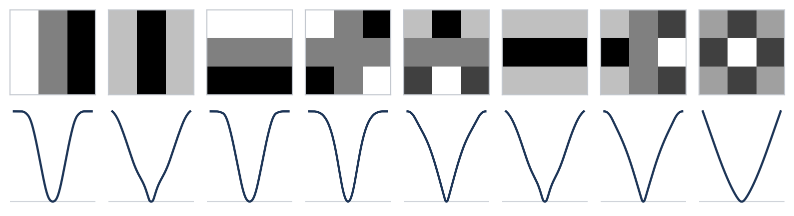

# Explicit Priors

[](https://github.com/HaouchatY/explicit-priors)
[](https://HaouchatY.github.io/explicit-priors/)

Explicit Priors fits fields-of-experts image priors in closed form: one linear solve, no training loop.

<p align="center"></p>
<p align="center"><sub>3×3 DCT filters and their MAP potentials, noise 25/255, 400 BSD images:
<code>python doc/make_figures.py --data path/to/BSD</code></sub></p>

## Setup

```bash
# user install
pip install explicit_priors@git+https://github.com/HaouchatY/explicit-priors.git

# developer install
git clone https://github.com/HaouchatY/explicit-priors.git
cd explicit-priors/
pip install -e ".[dev,doc,examples]"
pre-commit install

# run test suite
pytest src/explicit_priors_tests

# build HTML docs
python -m sphinx -b html doc doc/_build/html

# publish them on GitHub Pages
dev/publish_docs.sh
```
